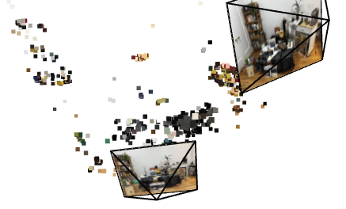
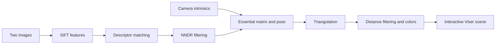
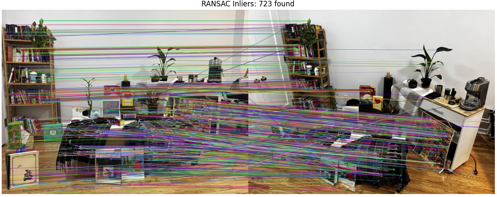
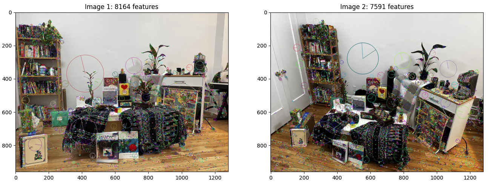
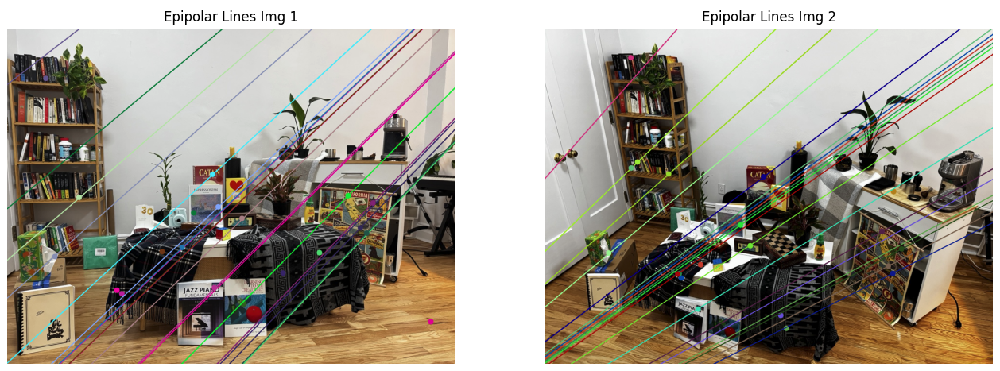
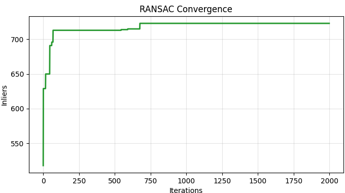

# Sparse 3D Reconstruction

**Recover relative camera pose and a colored sparse point cloud from two images.**

A two-view structure-from-motion project built with Python, OpenCV, NumPy, and Viser. The pipeline connects SIFT feature detection, descriptor matching, robust essential-matrix estimation, and triangulation, with visual diagnostics at each stage.

Developed by **Sanjaii Vijayakumar** for Columbia University's computer vision coursework.

[Pipeline report](https://github.com/sanjaiiv04/SfM-Sparse-3D-Reconstruction/blob/main/web/index.md) · [Source code](https://github.com/sanjaiiv04/SfM-Sparse-3D-Reconstruction/tree/main/code) · [Saved visualizations](https://github.com/sanjaiiv04/SfM-Sparse-3D-Reconstruction/tree/main/assets/results)



*A saved view of the reconstructed scene. The running application lets you inspect the colored points and both camera frustums in a browser.*

## What this project demonstrates

- **Multi-view geometry:** derive camera intrinsics, estimate epipolar geometry, and recover relative rotation and translation direction.
- **Robust correspondence selection:** combine descriptor-distance filtering with a custom RANSAC loop and Sampson-distance scoring.
- **3D reconstruction:** triangulate inlier correspondences, filter distant outliers, and sample image colors for the point cloud.
- **Visual debugging:** inspect keypoints, match ambiguity, epipolar lines, RANSAC convergence, and the final scene.

## Pipeline



1. **Camera intrinsics.** Compute focal lengths in pixels from the supplied focal length and sensor dimensions. Place the principal point at the image center.
2. **SIFT detection.** Extract keypoints and descriptors from grayscale versions of the two images using OpenCV's default SIFT configuration.
3. **Descriptor matching.** Find the two nearest neighbors with an L2 brute-force matcher. Keep matches whose nearest-to-second-nearest distance ratio is below **0.8**.
4. **Robust geometry.** Normalize coordinates with the intrinsic matrix and run **2,000 RANSAC iterations**. Score candidate essential matrices using a **0.005 Sampson-distance threshold in normalized coordinates**, then refine the selected inliers with OpenCV's LMedS estimator and recover relative pose.
5. **Triangulation.** Construct the two projection matrices and triangulate the selected correspondences. Remove points at or above the 95th percentile of distance from the first camera.
6. **Visualization.** Color points from the first image and display the cloud alongside image-textured camera frustums in Viser.

## Recorded results

The existing project report records the following results for the bundled image pair:

- **8,164 SIFT keypoints** in the first image and **7,591** in the second.
- **718 RANSAC inliers** in the reported run.
- A colored sparse reconstruction with both estimated camera viewpoints.

These describe one example run, rather than an aggregate benchmark. RANSAC samples are random and the scripts do not fix a seed, so the inlier count and reconstruction can vary between runs. The code does not currently compute ground-truth pose error or reprojection-error statistics.



*Correspondences retained by the geometric model in the saved run.*

<details>
<summary>More pipeline visualizations</summary>

### SIFT keypoints



### Epipolar geometry



### RANSAC convergence



</details>

## Run locally

Use a Python environment with desktop plot support; **Python 3.12** is a reasonable starting point. The repository does not currently pin dependency versions.

```bash
git clone https://github.com/sanjaiiv04/SfM-Sparse-3D-Reconstruction.git
cd SfM-Sparse-3D-Reconstruction
python3 -m venv .venv
source .venv/bin/activate
python -m pip install numpy opencv-python matplotlib viser
cd code
python triangulation.py
```

On Windows, activate the environment with `.venv\Scripts\activate` instead.

**Run from the `code` directory.** The image paths in `sift.py` and `intrinsics.py` are relative to the working directory and point to `../assets/staff_images/`.

The scripts execute earlier stages through imports. Several Matplotlib windows appear before the final viewer starts; close each plot window to let execution continue. Once Viser starts, open the URL printed in the terminal. Stop the server with **Ctrl+C**.

To inspect a particular stage, run one of these commands from `code/`:

```bash
python intrinsics.py
python sift.py
python nndr.py
python ransac.py
```

Later stages rerun their imported prerequisites. Diagnostic plots are displayed interactively; the scripts do not automatically export a point-cloud file or save new result images.

## Repository guide

```text
assets/
  staff_images/       Bundled input image pair
  results/            Saved plots and reconstruction screenshots
code/
  intrinsics.py       Camera intrinsic matrix
  sift.py             Keypoints and descriptors
  nndr.py             Matching and ratio-test diagnostics
  ransac.py           Essential matrix, pose, and inlier selection
  triangulation.py    Colored point cloud and Viser viewer
web/
  index.md            Original coursework report
```

## Assumptions & limitations

- **Two views, sparse output.** The implementation reconstructs one image pair; it does not include incremental multi-image reconstruction, dense reconstruction, or bundle adjustment.
- **Scale ambiguity.** Translation and reconstructed geometry are defined up to scale, without a known baseline or another metric reference.
- **Fixed camera parameters.** The supplied intrinsics assume the same camera for both images, a centered principal point, and the focal length and sensor dimensions in `intrinsics.py`. Lens distortion is not modeled.
- **Capture conditions matter.** Useful reconstruction requires overlapping views, sufficient texture and parallax, and a largely static scene. Repeated patterns and weak matches can degrade pose estimation.
- **Simple outlier filtering.** Distance-percentile filtering removes extreme points but does not replace reprojection-error filtering or full geometric validation.
- **Exploratory scripts.** Input paths and parameters are edited in the source. Degenerate or low-match inputs may fail without a descriptive error.

## Possible next steps

Add a command-line entry point, configurable inputs and intrinsics, deterministic sampling, reprojection-error reporting, point-cloud export, and bundle adjustment. These are extensions to the current implementation, not existing features.
